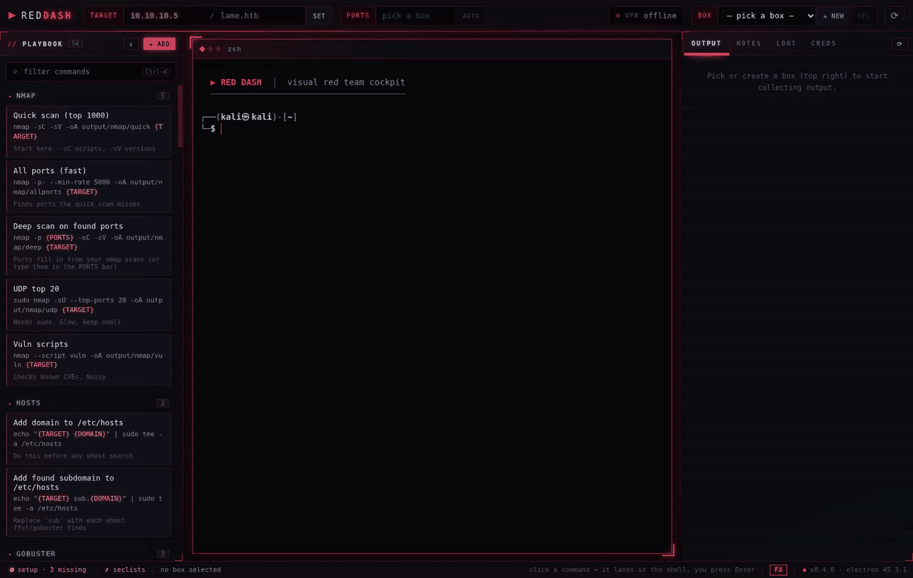
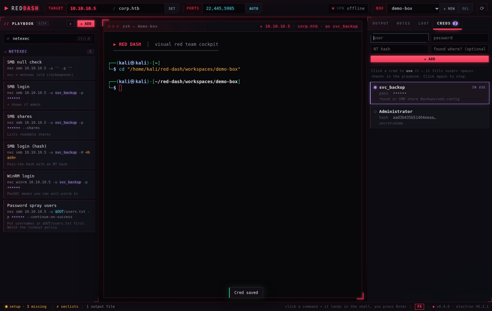

<div align="center">


# Red Dash

**A visual red team cockpit.** Terminal in the middle, your tools and their output around you.

[](https://github.com/HyperionFae/red-dash/actions/workflows/build.yml)
[](https://github.com/HyperionFae/red-dash/releases/latest)
[](LICENSE)


**[⬇ Download for Linux](https://github.com/HyperionFae/red-dash/releases/latest)** · [Features](#features) · [Install](#install) · [Use it](#use-it)



</div>

Stop digging through folders, re-running scans just to look at the results again, and forgetting what you already tried. Red Dash wraps the tools you already use (nmap, ffuf, netexec, impacket and more); it doesn't replace them.

> ⚠️ **For authorised testing and learning only** — your own labs, HTB, THM, or systems you have permission to test.

---

## Features

**Run**
- 🖥️ **Real terminal** in the centre: your own shell, your own tools
- 📖 **Playbook** of 70+ ready commands (recon, web, SMB/AD, privesc, pivoting): click one, it lands in the terminal with your target filled in, you press Enter
- 🎯 **Target bar**: set the IP / domain once, every command updates
- 🧰 **Toolbox**: reverse-shell generator (LHOST from your VPN, copy or send to terminal) and a hash identifier (type + `hashcat -m` mode + one-click crack)
- ➕ **Your own commands**: add them in one click; updates never overwrite them

**See**
- 📊 **Parsed output**: nmap, ffuf, gobuster, feroxbuster, nikto, wpscan and whatweb results become clean tables, live while the scan runs
- 🔌 **Auto ports**: open ports from your nmap scans fill `{PORTS}` for the next scan automatically
- 🔑 **Creds tab**: save users, passwords and NT hashes; click one and every login command fills itself in (pass-the-hash too). Passwords stay masked on screen

**Keep track**
- 📦 **One box per target**: output, notes, loot, creds and checklist kept separate
- ✔️ **Checklist**: each box starts with an HTB/THM flow (recon → foothold → privesc → flags); tick it off or make your own
- 📝 **Notes + Loot** tabs, autosaved
- ✅ **Setup check**: finds missing tools and SecLists and gives you the install command for your distro (pacman, apt, dnf, zypper, apk)
- 🛰️ **VPN status**: shows your HTB/THM VPN IP, click to copy

**Looks**
- ✨ **Cyber HUD** theme with glow, glass panels and scanlines. Too much? The **FX** button turns effects off



---

## Install

### Download (easiest)

Grab the latest from **[Releases](https://github.com/HyperionFae/red-dash/releases/latest)**:

| File | For |
|---|---|
| `red-dash-x.y.z-amd64.deb` | Kali, Ubuntu, Debian, Parrot — `sudo apt install ./red-dash-*.deb` |
| `red-dash-x.y.z-x86_64.AppImage` | Any Linux — `chmod +x red-dash-*.AppImage` then run it |

Then open **Red Dash** from your app menu. Your boxes, notes and creds are kept in `~/.config/red-dash`.

> The AppImage needs FUSE. On Ubuntu 24.04+ AppImages can also be blocked by AppArmor's user-namespace rule. If it won't start, use the `.deb`.

### From source

Needs Node.js, npm and build tools (`build-essential` / `base-devel`).

```bash
git clone https://github.com/HyperionFae/red-dash.git
cd red-dash
npm install
npm start
```

`./install-launcher.sh` adds it to your app menu; `./launch.sh` starts it detached from the terminal. If the terminal ever fails to start after an upgrade, run `npm run setup`. Running from source keeps your data inside the repo folder (git-ignored).

---

## Use it

1. **Set a target**: IP (and domain if there is one), press Enter
2. **New box**: one per machine you're working on
3. **Click a playbook command**: it drops into the terminal, press Enter
4. **Read the results** on the right: parsed tables, no re-running
5. **Found creds?** Add them in the **Creds** tab and every login command fills itself in

Shortcuts: `Ctrl+Shift+K` filter the playbook · `Ctrl+S` save notes · `Ctrl+C` copies when text is selected

### Your own commands

Click **+ ADD** in the playbook. These fill in automatically:

| Variable | Becomes |
|---|---|
| `{TARGET}` / `{DOMAIN}` | the target bar |
| `{OUT}` | this box's output folder |
| `{WORDLIST}` / `{SUBLIST}` | SecLists web / DNS lists, found automatically |
| `{PORTS}` | open ports from your nmap scans (or the PORTS bar) |
| `<user>` `<pass>` `<hash>` | the cred in use from the Creds tab |

---

## Security

Red Dash is a **local, single-user tool**. It's not meant to be exposed to a network.

- The UI is sandboxed (`contextIsolation`, no Node integration, strict Content-Security-Policy) and can only reach a fixed list of IPC channels.
- Scan output is HTML-escaped before display, so a hostile target's response can't run code in the app.
- The output viewer only reads files inside the current box; box names are restricted to safe characters.
- Creds are stored in plain text in the box's `box.json`. They're masked on screen and shell-quoted when inserted, but they end up in your shell history like any typed command.

---

## Built with

Electron · xterm.js · node-pty. Plain HTML/CSS/JS, no framework.

See the [Changelog](CHANGELOG.md) for what's new.

## License

MIT, see [LICENSE](LICENSE). You are responsible for how you use it.
